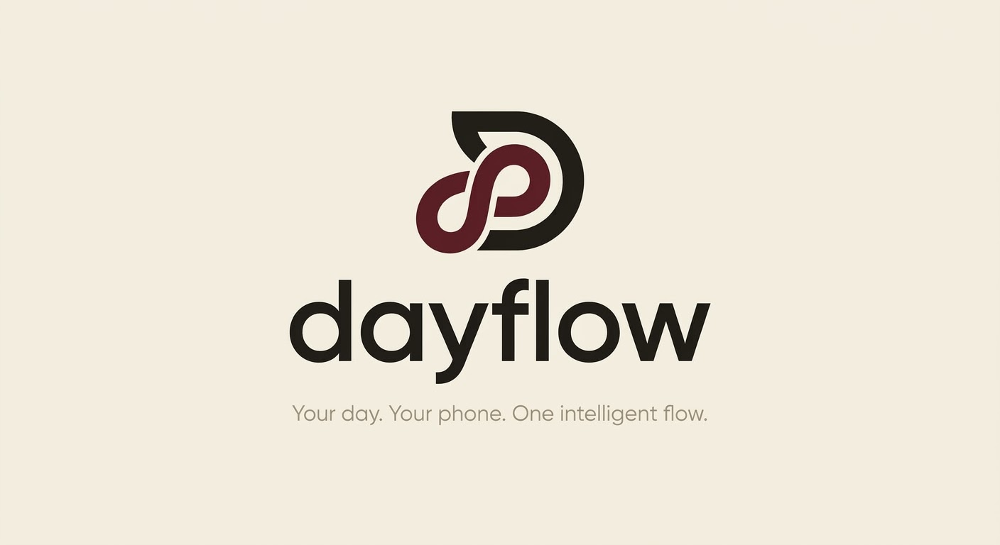

<div align="center">



# Dayflow

**Your day. Your phone. One intelligent flow.**

[](https://github.com/norobb/dayflow-assistant/actions/workflows/deploy.yml)
[](https://github.com/norobb/dayflow-assistant/actions/workflows/android.yml)
[](LICENSE)

[](https://github.com/norobb/dayflow-assistant/releases/download/ci-latest/dayflow-ci.apk)

[Live demo](https://norobb.github.io/dayflow-assistant/) · [Documentation](docs/) · [Contributing](CONTRIBUTING.md)

</div>

---

Dayflow turns scattered information (chat messages, screenshots, PDFs and voice notes) into calendar events, tasks, reminders and daily context. It ships as an interactive web demo and a native Android app.

## Features

| | |
|---|---|
| **Multi-modal input** | Messages, screenshots, multi-page PDFs and voice notes |
| **Structured extraction** | Events, tasks, time-anchored reminders and proactive insights |
| **Screen Intelligence** (Android) | On-device screen context via an accessibility service, with a safety gate for every action |
| **Share Sheet** (Android) | Send content from any app straight to Dayflow |
| **Live sync** (Web) | Dashboard, phone simulator and summary grid update together |
| **Offline fallback** | Deterministic local analysis when no AI key is configured |
| **Localization** | English, German and Spanish |

## How it works

```
message · screenshot · PDF · voice note
                 │
                 ▼
        AI analysis (Gemini, or the local fallback)
                 │
                 ▼
   events · tasks · reminders · insights
                 │
                 ▼
     Web dashboard  ·  Android app
```

## Project structure

```
dayflow-assistant/
├── website/      React 19 + Vite 8 + Tailwind CSS v4 web demo
├── android/      Kotlin / Jetpack Compose app (minSdk 26, targetSdk 35)
├── docs/         Architecture, development and design-system docs
└── .github/      CI, Pages deployment and APK build workflows
```

## Getting started

### Web

Requires Node.js 22+ and pnpm 10+.

```bash
git clone https://github.com/norobb/dayflow-assistant.git
cd dayflow-assistant
pnpm install
cp .env.example .env    # optional: add GEMINI_API_KEY
pnpm run dev            # http://localhost:3000
```

| Command | Purpose |
|---|---|
| `pnpm run dev` | Start the dev server on port 3000 |
| `pnpm run lint` | Run the TypeScript type check (required before a PR) |
| `pnpm run build` | Build the static production site to `dist/` |
| `pnpm run preview` | Serve the production build locally |

### Android

Requires JDK 17 and the Android SDK.

```bash
cd android
./gradlew assembleDebug
```

CI attaches a debug APK to every run of the [Android workflow](.github/workflows/android.yml). Every push to `main` also publishes a signed APK as the rolling [`ci-latest`](https://github.com/norobb/dayflow-assistant/releases/tag/ci-latest) prerelease: [download it directly](https://github.com/norobb/dayflow-assistant/releases/download/ci-latest/dayflow-ci.apk), or update in the app under Settings → Updates → CI. It is signed with the same key as the releases, so it installs over an existing Dayflow.

## Configuration

| Variable | Required | Description |
|---|---|---|
| `GEMINI_API_KEY` | No | Enables Gemini analysis. Without it, Dayflow uses the local fallback. |
| `APP_URL` | No | Hosting URL, `http://localhost:3000` by default |

See [`.env.example`](.env.example) for all options. Never commit real keys.

## Tech stack

**Web:** React 19, TypeScript 7, Vite 8, Tailwind CSS v4, Motion 12, Lucide, Google Gemini (`@google/genai`)
**Android:** Kotlin, Jetpack Compose, Room, Accessibility and Notification Listener services

## Roadmap

- [x] Interactive web demo with Gemini integration
- [x] Localization (en / de / es)
- [x] Native Android app (beta)
- [x] Screen Intelligence and Screen Agent (Android)
- [ ] Multi-provider AI abstraction
- [ ] Server-side API proxy

## Documentation

- [Architecture](docs/architecture.md): components, state and data flow
- [Development](docs/development.md): branch strategy and workflow
- [Design system](docs/design-system.md): color, type, spacing and motion
- [AGENTS.md](AGENTS.md): detailed context for AI coding agents

## Contributing

Contributions are welcome. Read [CONTRIBUTING.md](CONTRIBUTING.md) for branch strategy, commit conventions and the PR checklist.

## License

Released under the [MIT License](LICENSE).
